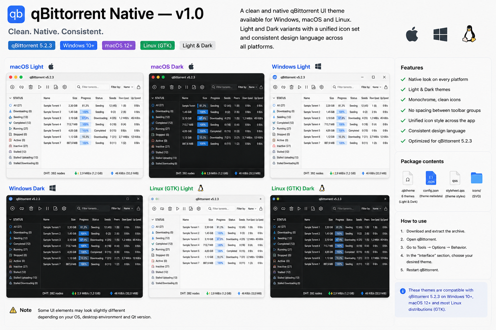

# qBittorrent Native Theme

A clean, compact qBittorrent theme pack with monochrome icons and a light/dark variant. One `.qbtheme` per color mode — no per-OS builds to pick between.

> Current release: **v2.0**
> Built around qBittorrent 5.x.

## Themes

| Mode | File |
|---|---|
| Light | `themes/light.qbtheme` |
| Dark | `themes/dark.qbtheme` |

## Features

- Compact 24 px monochrome toolbar icons
- Matching Preferences/sidebar icon set
- Light and dark variants
- One shared stylesheet per mode, verified against the same qBittorrent toolbar layout on every OS instead of maintaining six near-duplicate builds
- Dark mode forces its own palette instead of depending on OS dark mode, so it looks correct even if your system is set to light
- Reduced visual clutter and restrained accent colors
- No SF Symbols or proprietary Apple icon assets; the SVG set is custom-made

## Installation

1. Download `themes/light.qbtheme` or `themes/dark.qbtheme` (whichever mode you want).
2. Open qBittorrent.
3. Go to **Tools / Preferences -> Behavior -> Interface**.
4. Enable **Use custom UI Theme** and select the `.qbtheme` file.
5. Fully quit qBittorrent and launch it again.

## Source layout

Each folder under `source/` (`light/`, `dark/`) contains:

- `stylesheet.qss`
- `config.json`
- `resources.qrc`
- `icons/` SVG resources

The compiled `.qbtheme` files are kept separately in `themes/` for simple installation.

## Compatibility notes

qBittorrent is a Qt application, so some widget metrics and native controls can differ between Qt versions and operating systems. Earlier releases of this theme shipped separate macOS/Windows/Linux builds to account for this; a source-level audit found the actual per-OS differences were limited to a couple of color values and a border-radius, while the one substantive fix — a toolbar workaround described below — turned out to be identical across all of them. Both `light.qbtheme` and `dark.qbtheme` now ship that same fix and are meant to work unmodified regardless of OS.

qBittorrent (as of 5.2.3) turns toolbar separators into plain `QWidget` spacers rather than real `QToolBar::separator` objects, and styling `QToolButton` directly in that toolbar was found (via direct A/B testing) to misplace the leading search icon in the neighboring "Filter torrents" field. Both themes leave `QToolButton` unstyled in that toolbar and instead hide the spacer widgets by their `minimumWidth` property — see the comments in `source/*/stylesheet.qss` for the exact mechanism.

## Known limitations

- Light/Dark switching is not automatic; select the corresponding `.qbtheme` manually — this is a qBittorrent limitation (one theme resource loaded at a time), not something a theme file can work around.
- Linux appearance can vary between desktop environments and Qt styles.
- Some qBittorrent versions may use slightly different resource names or widget metrics.
- Only the previous macOS Light build had been verified on real qBittorrent; the merged Light/Dark themes carry that verification forward for the toolbar fix, but haven't yet been screenshot-tested across every OS. Feedback/issues welcome.

The six previous per-platform builds are still available in this repository's git history if you need one for reference.

## Support

If you enjoy this theme, you can [support me on Ko-fi](https://ko-fi.com/zettts) to support its development. Thank you for your support!

## License

Theme code and custom SVG icons in this repository are released under the MIT License. qBittorrent is a separate project and is not affiliated with this theme.
